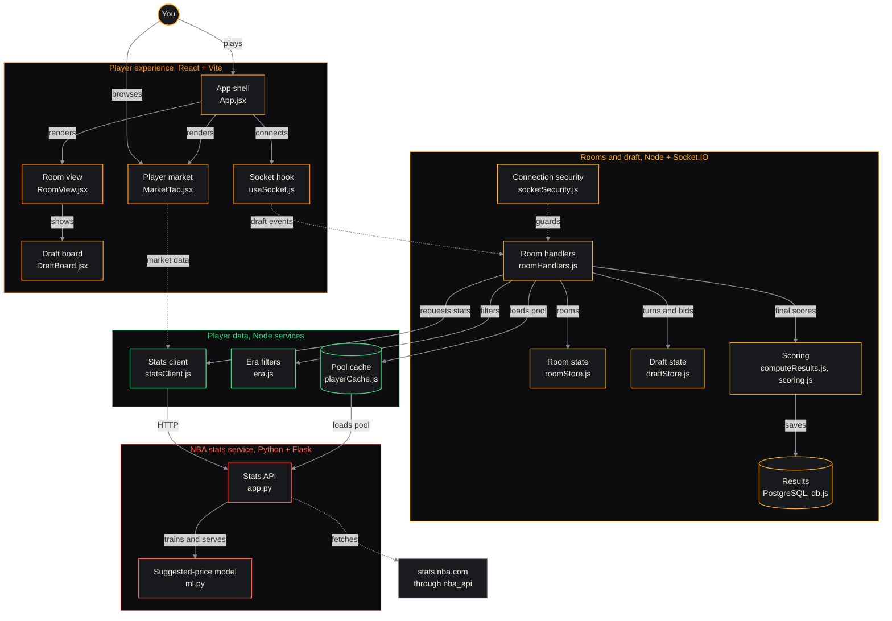

```
██      ██  ██████████  ██████████  ██████████        ████████    ██  ████████    ██████████
██      ██  ██      ██  ██      ██  ██      ██        ██      ██  ██  ██      ██  ██
██████████  ██      ██  ██      ██  ██████████        ████████    ██  ██      ██  ██████████
██      ██  ██      ██  ██      ██  ██                ██      ██  ██  ██      ██          ██
██      ██  ██████████  ██████████  ██                ████████    ██  ████████    ██████████
```

> A multiplayer NBA auction draft, built on real stats.nba.com data, scored by a formula you can read.


---

## The quick version

Up to 8 people join a room with a code. Everyone starts with the same 20-coin
budget and an empty 5-slot roster (PG, SG, SF, PF, C). On your turn you reveal
a random real NBA player, the room bids on them, and the winner drops them into
an open slot. When every roster is full, the app scores all five-man teams from
real career stats and ranks the room, with a win-probability estimate for every
matchup.

No accounts, no sign-up. Every player, headshot, and stat is pulled live from
the NBA's own data, so the pool runs from today's rookies back to Wilt
Chamberlain. You can set a room to a single decade, the current season only, or
all eras at once.

A few things that make it feel finished:

- **Real data, real IDs.** Every player carries their actual NBA.com person ID, so headshots and stats never rely on fragile name matching.
- **Drop and reconnect.** Your seat, budget, and roster are tied to a saved identity, not the socket. Close the tab or lose wifi, reopen, and you are back exactly where you were. Gone for 60 seconds mid-draft and the room moves on without you.
- **A player market.** Browse every player with a "suggested value" that a price model keeps re-learning from how real drafts actually bid.
- **Solo mode.** Draft against yourself with one reroll for the whole run.

## By the numbers

| | |
|---|---|
| Player stat lines cached | **5,271** |
| Active players this season (2026-27) | **441** |
| Headshots cached | **3,378** |
| Award records | **2,282** |
| Usage-rate entries (player, season) | **14,569** |
| Services | **3** (React, Node, Python) |
| Room size | **1 to 8** players |
| Data refresh | **weekly**, every Saturday |

## How it fits together



Solid arrows are request and response. Dashed arrows are live socket traffic
or an outbound call to the NBA.

**Jump to source**

- **Client**: [`App.jsx`](https://github.com/Gaarbra/nba-auction-draft/blob/main/client/src/App.jsx) · [`RoomView.jsx`](https://github.com/Gaarbra/nba-auction-draft/blob/main/client/src/components/RoomView.jsx) · [`DraftBoard.jsx`](https://github.com/Gaarbra/nba-auction-draft/blob/main/client/src/components/DraftBoard.jsx) · [`MarketTab.jsx`](https://github.com/Gaarbra/nba-auction-draft/blob/main/client/src/components/MarketTab.jsx) · [`useSocket.js`](https://github.com/Gaarbra/nba-auction-draft/blob/main/client/src/hooks/useSocket.js)
- **Rooms and draft**: [`roomHandlers.js`](https://github.com/Gaarbra/nba-auction-draft/blob/main/server/src/sockets/roomHandlers.js) · [`roomStore.js`](https://github.com/Gaarbra/nba-auction-draft/blob/main/server/src/rooms/roomStore.js) · [`draftStore.js`](https://github.com/Gaarbra/nba-auction-draft/blob/main/server/src/rooms/draftStore.js) · [`computeResults.js`](https://github.com/Gaarbra/nba-auction-draft/blob/main/server/src/scoring/computeResults.js) · [`scoring.js`](https://github.com/Gaarbra/nba-auction-draft/blob/main/server/src/scoring/scoring.js) · [`socketSecurity.js`](https://github.com/Gaarbra/nba-auction-draft/blob/main/server/src/middleware/socketSecurity.js) · [`db.js`](https://github.com/Gaarbra/nba-auction-draft/blob/main/server/src/services/db.js)
- **Player data**: [`playerCache.js`](https://github.com/Gaarbra/nba-auction-draft/blob/main/server/src/services/playerCache.js) · [`era.js`](https://github.com/Gaarbra/nba-auction-draft/blob/main/server/src/services/era.js) · [`statsClient.js`](https://github.com/Gaarbra/nba-auction-draft/blob/main/server/src/services/statsClient.js)
- **Stats service**: [`app.py`](https://github.com/Gaarbra/nba-auction-draft/blob/main/stats-service/app.py) · [`ml.py`](https://github.com/Gaarbra/nba-auction-draft/blob/main/stats-service/ml.py)

## The stack

- **Frontend** (`client/`): React 18 on Vite, Socket.IO client, GSAP and Motion for the animation, Lenis for scrolling. Styled like a dark, high-contrast scoreboard.
- **Backend** (`server/`): Node and Express with Socket.IO. In-memory room store, a draft state machine, the player-pool cache, and the end-of-draft scoring.
- **Stats service** (`stats-service/`): Python and Flask wrapping `nba_api`, the free, unofficial wrapper around stats.nba.com. Player pool, per-game career stats, headshots, usage rates, and the suggested-price model.
- **Data and infra**: PostgreSQL for saved results, Docker Compose and Caddy in production. A weekly systemd timer refreshes NBA data through a proxy so gameplay always serves saved data, never a live scrape.

## How scoring works

When every roster is full, the server pulls full stats for all drafted players
([`computeResults.js`](https://github.com/Gaarbra/nba-auction-draft/blob/main/server/src/scoring/computeResults.js))
and scores each team with pure, unit-tested functions
([`scoring.js`](https://github.com/Gaarbra/nba-auction-draft/blob/main/server/src/scoring/scoring.js),
runnable with `npm test --prefix server`). Each per-game stat comes straight
from `nba_api`.

**Offense (Op)** per player:

```
TS% = PTS / (2 * (FGA + 0.44 * FTA))      (0 when FGA and FTA are both 0)
Op  = (PTS * TS%) + (AST * 1.5) - (TOV * 2.0)
```

**Defensive Impact Rating (DIR)** per player:

```
DIR = (STL * 2.0) + (BLK * 2.5)           when steals and blocks were tracked
DIR = (Season DWS / Games Played) * 100   pre-1973-74, when they were not
```

Rebounds are left out of DIR on purpose. They track role and opportunity more
than defense (and the raw number even includes offensive boards), so counting
them made high-rebounding bigs read as elite defenders when they were not.
Blocks weigh a little over steals, since steals reward gambling and both are
rare events. Box-score defense is a weak proxy at best, which is the same
reason Basketball-Reference's Box Plus/Minus can only derive its defensive
half indirectly.

**Team Synergy Multiplier (Ms)**, from the five starters' combined usage:

```
Ms = 1.10   if sum(USG%) <= 105
Ms = 1.00   if 105 < sum(USG%) <= 125
Ms = 0.85   if sum(USG%) > 125
```

**Final Team Score** = `sum(Op + DIR over the 5 starters) * Ms`.

Two stats do not exist in any free, official source, so they are estimated and
flagged ([`statsAdapter.js`](https://github.com/Gaarbra/nba-auction-draft/blob/main/server/src/scoring/statsAdapter.js)): USG% before 1996-97 (from shot
volume per 36 minutes) and pre-1974 Defensive Win Shares (from rebounds per
game). The results screen marks any estimated value.

## Where the data comes from

The full draft pool (around 5,300 players, active and historical) is one bulk
`nba_api` call, not a scrape of thousands of pages. Each entry carries the real
NBA.com person ID, `isActive`, and career span, so the pool can be filtered by
decade, by current roster, or all eras at once. Stats are fetched per player
and cached, with the mid-season "TOT" row used for traded players so games
played are never double-counted. Steals, blocks, and turnovers from before
they were tracked come back as `N/A`, not a misleading `0.0`.

The suggested-price model behind the market
([`train_price_model.py`](https://github.com/Gaarbra/nba-auction-draft/blob/main/stats-service/scripts/train_price_model.py)) retrains weekly on the accumulated
draft history and hot-reloads into the serving container with no restart. Solo
picks are excluded from its training data, since a price nobody competed for is
not a real market signal.

## Running it

This is a personal project. It runs on my own server, and the repository is
here to read, not to deploy. The gameplay, data pipeline, scoring, and the
weekly refresh are all documented below for anyone who wants to see how it is
built.

- [SERVERCHEAP.md](SERVERCHEAP.md): production setup, updates, backups, and the Saturday data refresh.
- [ACTIVE_NOW.md](ACTIVE_NOW.md): the current-season player snapshot and how it is scored.
- [PRODUCT.md](PRODUCT.md): design and product context.
- [LEGAL_REVIEW.md](LEGAL_REVIEW.md): outstanding privacy and content-rights notes.

## Project structure

```
client/                React (Vite) frontend, the whole scoreboard UI
server/                Express + Socket.IO backend, room store, draft state machine
server/src/scoring/    Op / DIR / Ms scoring (pure, unit-tested) + stats adapter
stats-service/         Flask + nba_api: player pool, stats, headshots, price model
```

## Security

Built for casual play with friends over a shared room code, not for public
discovery, so there is no account system. The baseline hardening for the open
internet is here anyway: per-connection and per-IP rate limiting on room
creation and every draft action, server-side input validation that never just
trusts the client, generic production error responses, standard security
headers, and an admin-token gate on the one endpoint that can force a full
data resync.

## License

All Rights Reserved. See [LICENSE](LICENSE). The code is public to read and
learn from; it is not licensed for reuse, redistribution, or hosting. NBA
marks, names, stats, and imagery belong to their respective owners and are
used here for non-commercial, informational purposes. This project is not
affiliated with or endorsed by the NBA.